# CAELUS — İLK GERÇEK GÖREV MİMARİSİ
## Kullanıcı Verisi, Dünya Modeli, Senaryo Analizi ve Açıklanabilir Rapor Paketi

---

## 1. Depo, Ana Dal ve Açık PR Bağımlılık Durumu (Dürüst Durum Tespiti)

Bu çalışma öncesinde GitHub deposu ve yerel çalışma ağacı incelenmiş, gerçek durum aşağıda kayıt altına alınmıştır:

- **`origin/main` Son Commit**: `3cf158e` (`2026-11-09 14:37:17 +0300`, `Merge pull request #13 from borabirhekimoglu8-ops/feat/caelus-world-reality-validation`).
- **Birleştirilmiş (Merged) PR’lar**: `#7`, `#8`, `#9`, `#11`, `#12`, `#13`.
- **Birleştirilmemiş Açık Draft PR’lar**:
  - **PR #14** (`feat/caelus-living-world-model`): Yaşayan Dünya Modeli, Çift Zamanlı Hafıza ve Hipotez Defteri (`ui/living_world_model.js`).
  - **PR #15** (`feat/caelus-discovery-value-engine`): Keşif ve Bilgi Değeri Motoru + 11 Araçlı MCP Sunucusu (`ui/discovery_value_engine.js`, `tools/caelus_mcp_server.mjs`).
  - **PR #16** (`feat/caelus-spatial-interface`): Başlıksız, Sahne Merkezli Mekânsal Arayüz (`#caelus-spatial-compass`, `#caelus-stage-top-right-pod`).
- **Mimari Uygulama Yolu**:
  - Görev kuralları gereği `main` dalına doğrudan yazılmamış ve açık PR’lar birleştirilmemiştir.
  - Aynı kodu yeniden yazmamak ve kullanıcının onayladığı başlıksız mekânsal arayüzü (Bölüm 17) korumak için `feat/caelus-first-real-task` dalı mevcut çalışma yığını üzerinde oluşturulmuş; hangi yeteneğin `origin/main` (`3cf158e`) içinde, hangilerinin açık PR yığınında (`#14`, `#15`, `#16`) ve hangilerinin bu dalda (`feat/caelus-first-real-task`) eklendiği açıkça ayrılmıştır.

---

## 2. Altı Katmanlı Mimari Yapı

CAELUS İlk Gerçek Görev mimarisi, çekirdek deterministik motoru dış dosya okuma ve raporlama adaptörlerinden kesin sınırlarla ayıran **6 katmandan** oluşur:

```mermaid
flowchart LR
  subgraph L_A["Katman A: Dosya Okuma"]
    A1["Rust Calamine 0.38.0\n(tools/caelus_xlsx_engine)"]
    A2["CAELUS Offline OpenXML & CSV\n(ui/first_real_task_engine.js)"]
  end
  subgraph L_B["Katman B: Veri Anlama & Eşleme"]
    B1["Türkçe/İngilizce Başlık Normalleştirici"]
    B2["Kurallı Tip Çıkarımı & Kullanıcı Override"]
  end
  subgraph L_C["Katman C: Sürümlü Veri Sözleşmesi"]
    C1["CAELUS_DATA_PACKAGE_V1\n(18 Zorunlu Alan)"]
    C2["Satır Bazlı Hata İzolasyonu"]
  end
  subgraph L_D["Katman D: Varlık Eşleştirme & Hafıza"]
    D1["Kurumsal Kök Normalleştirici\n(Birleştir / Ayrı Tut Onaylı)"]
    D2["Dünya Modeli & ScenarioPack v2.0"]
  end
  subgraph L_E["Katman E: Senaryo & Karşılaştırma"]
    E1["Deterministik Sabit Noktalı Motor\n(Müdahalesiz vs Seçenek 1 vs Seçenek 2)"]
  end
  subgraph L_F["Katman F: Açıklanabilir Rapor & MCP"]
    F1["7 Sayfalı .XLSX (rust_xlsxwriter + JS)"]
    F2["Çok Sayfalı HTML/PDF (@media print)"]
    F3["Formül Korumalı .CSV & 10 MCP Aracı"]
  end
  L_A --> L_B --> L_C --> L_D --> L_E --> L_F
```

### Katman A — Dosya Okuma Katmanı
- **Rust `Calamine` (`0.38.0`, `tools/caelus_xlsx_engine/src/main.rs`)**: `.xlsx`, `.xlsm`, `.ods` çalışma kitaplarını okur; `worksheet_range` ve `worksheet_formula` aralıklarını birleştirerek her hücre için `LITERAL_VALUE`, `FORMULA_WITH_CACHED_VALUE` ve `FORMULA_UNCOMPUTED` durumlarını birbirinden ayırır. `vbaProject.bin` makrolarını tespit eder, asla çalıştırmaz ve `MACRO_DETECTED_STRIPPED_READ_ONLY` uyarısı üretir.
- **Tarayıcı / Mobil Çevrim Dışı Okuyucu (`ui/first_real_task_engine.js`)**: Masaüstü sunucusu olmadan tarayıcıda ve iPhone PWA modunda `.xlsx` (ZIP Central Directory + RFC 1951 Deflate + OpenXML `sharedStrings.xml` / `sheet*.xml`) ve `.csv` / `.tsv` dosyalarını okur; `Calamine` ile birebir aynı hücre ve formül ayrımını üretir.

### Katman B — CAELUS Veri Anlama ve Sütun Eşleme Motoru
- Zorunlu LLM çağrısı yapmadan çalışır.
- Türkçe ve İngilizce sütun başlıklarını (`Şirket Adı`, `Tedarikçi Kurum`, `Kritiklik_Skoru`, `Tarih`, `Bagimli_Altyapi`, `Yedeklilik_Saati` vb.) normalleştirir ve örnek satırlardan tip çıkarımı (`TEXT`, `RATIO_0_1`, `NUMBER`, `DATE_ISO`, `FORMULA_OR_DERIVED`) yapar.
- Her önerinin hangi kuraldan (`RULE_TR_EN_SOURCE_ENTITY` vb.) geldiğini açıklar ve kullanıcının arayüz üzerinden her sütunun hedef rolünü değiştirmesine (`USER_OVERRIDE_CONFIRMED`) olanak tanır.

### Katman C — Sürümlü Veri Sözleşmesi ve Doğrulama Motoru (`CAELUS_DATA_PACKAGE_V1`)
- Her geçerli kayıt 18 zorunlu alanı taşır:
  `schema_version`, `dataset_id`, `source_file`, `source_hash`, `source_sheet`, `source_row`, `imported_at`, `occurred_at`, `learned_at`, `entity_id`, `entity_type`, `relation_type`, `unit`, `value`, `epistemic_status`, `mapping_method`, `validation_status`, `user_confirmation`.
- **Satır Bazlı Hata İzolasyonu**: Bozuk tarih (`2026-02-30`), sayısal sütunda metin (`BOZUK_SKOR`) veya boş zorunlu alan içeren satırlar tüm dosyayı çökertmez; `import_errors` listesinde satır numarası, sütun adı ve düzeltme önerisiyle raporlanırken geçerli satırlar korunur.

### Katman D — Açıklanabilir Varlık Eşleştirme ve Dünya Hafızası Köprüsü
- `"Alfa Teknoloji A.Ş."`, `"ALFA TEKNOLOJI AS"` ve `"Alfa Teknoloji"` gibi farklı yazımları Türkçe karakter ve kurumsal unvan (`A.Ş.`, `AS`, `Ltd.`) normalleştirmesiyle aday küme olarak yakalar.
- **Sessiz Otomatik Birleştirme Yasağı**: Kullanıcı açıkça **`Birleştir`** (`MERGE`) veya **`Ayrı Tut`** (`KEEP_SEPARATE`) kararı verene kadar varlıklar sessizce birleştirilmez. Birleştirildiğinde tüm kaynak satır izleri (`source_rows: [2, 3, 4]`) korunur.

### Katman E — Gerçek Deterministik Senaryo ve Karşılaştırma Köprüsü
- Kullanıcının doğrulanmış varlık ve ilişkilerinden `ScenarioPack` (`schema_version: "2.0"`) üretir ve sabit noktalı (fixed-point) yayılım motorunda **Müdahalesiz Temel Akış**, **Seçenek 1** ve **Seçenek 2** koşularını çalıştırır.
- Sonuçlarda **Kullanıcı Verisi (`[● KAYNAKTA_IDDIA_EDILEN]`)**, **Model Varsayımı (`[◆ VARSAYILAN]`)**, **Simülasyon Çıktısı (`[▲ SIMULE_EDILEN]`)** ve **Eksik/Hatalı Veri (`[✖ BILINMEYEN]`)** birbirinden açıkça ayrılır.

### Katman F — Açıklanabilir Raporlama ve 10 Araçlı MCP Katmanı
- **7 Sayfalı `.xlsx` Raporu**: `1. Özet`, `2. Varlıklar`, `3. İlişkiler`, `4. Senaryo Karşılaştırması`, `5. Varsayımlar`, `6. Hatalar ve Eksik Veriler`, `7. Kaynak İzleri` sayfalarını hem Rust `rust_xlsxwriter` (`0.79.4`) hem de tarayıcı çevrim dışı OpenXML üreticisiyle oluşturur.
- **Çok Sayfalı HTML/PDF Baskı Raporu**: `@media print` sayfa kırılımı kuralları ve renkten bağımsız sembollerle çok sayfalı rapor üretir.
- **Formül Enjeksiyon Korumalı `.csv`**: `=`, `+`, `-`, `@`, `\t`, `\r` ile başlayan tüm hücreleri `'` önekiyle etkisizleştirir.
