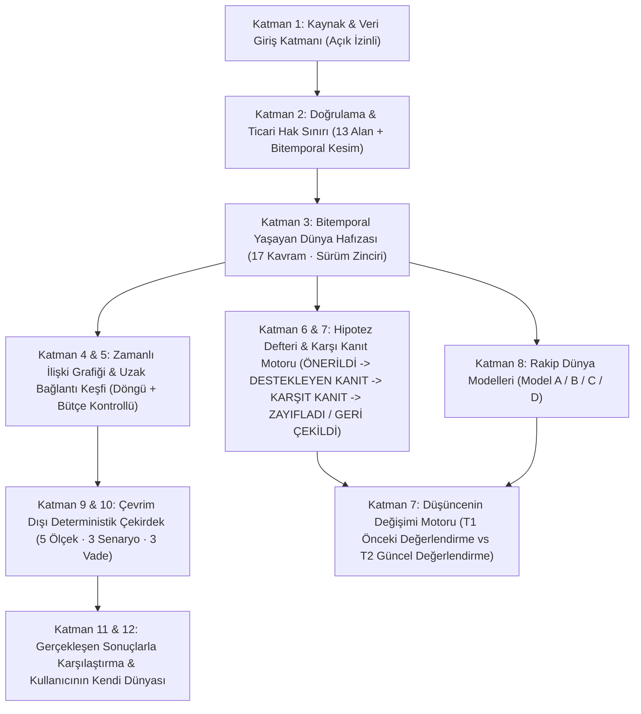

# CAELUS — Yaşayan Dünya Modeli Mimarisi

- **Depo:** `https://github.com/borabirhekimoglu8-ops/CAELUS`
- **Çalışma Dalı:** `feat/caelus-living-world-model`
- **Birincil Modüller:** [`ui/living_world_model.js`](file:///c:/Users/Lenovo/Desktop/CAELUS-main/ui/living_world_model.js), [`ui/scenario_compiler.js`](file:///c:/Users/Lenovo/Desktop/CAELUS-main/ui/scenario_compiler.js), [`caelus_core/src/lib.rs`](file:///c:/Users/Lenovo/Desktop/CAELUS-main/caelus_core/src/lib.rs), [`src/causal_engine.hpp`](file:///c:/Users/Lenovo/Desktop/CAELUS-main/src/causal_engine.hpp), [`ui/app.js`](file:///c:/Users/Lenovo/Desktop/CAELUS-main/ui/app.js)

---

## 1. Mevcut Sistem ve Stratejik Dönüşüm

CAELUS; C++17 ([`src/causal_engine.hpp`](file:///c:/Users/Lenovo/Desktop/CAELUS-main/src/causal_engine.hpp)), `#![no_std]` Rust ([`caelus_core/src/lib.rs`](file:///c:/Users/Lenovo/Desktop/CAELUS-main/caelus_core/src/lib.rs)), WebAssembly ([`caelus_wasm/src/lib.rs`](file:///c:/Users/Lenovo/Desktop/CAELUS-main/caelus_wasm/src/lib.rs)) ve JavaScript senaryo derleyicisi ([`ui/scenario_compiler.js`](file:///c:/Users/Lenovo/Desktop/CAELUS-main/ui/scenario_compiler.js)) üzerinde çalışan deterministik bir nedensel karar motoruna sahiptir.

Bu çalışmayla birlikte CAELUS, tek bir zaman kesitinde çalışan statik bir senaryo hesaplayıcısından; **bilgiyi zaman içinde koruyan, düzeltme ve geri çekmelerin geçmiş sürümlerini silmeyen, iki farklı tarihteki kendi değerlendirmesini karşılaştırabilen ("Düşüncenin Değişimi"), hipotezleri karşı kanıtlarla güncelleyen, rakip dünya açıklamalarını (Model A/B/C/D) yan yana tutan ve ticari/hava boşluklu (air-gapped) dağıtıma uygun** bir **Yaşayan Dünya Modeli (`CaelusLivingWorldModel`)** mimarisine kavuşturulmuştur.

---

## 2. CAELUS’a Özgü 14 Katmanlı Mimari

| Katman # | Katman Adı | Gerçek Kod Karşılığı (Dosya & Fonksiyon) | Sorumluluk Sınırı |
|---|---|---|---|
| **1** | **Kaynak ve Veri Giriş Katmanı** | [`ui/scenario_compiler.js`](file:///c:/Users/Lenovo/Desktop/CAELUS-main/ui/scenario_compiler.js#L15625-L15748) (`ingestFromExternalDataLayer`, `EXTERNAL_DATA_INGESTION_LAYER_CATALOG`) | Yalnızca açıkça etkinleştirildiğinde dış kaynaklardan veya kullanıcı dosyalarından veri alır; ham yükün SHA-256 özetini ve alım zamanını kaydeder. |
| **2** | **Veri Sözleşmesi ve Doğrulama Sınırı** | [`ui/scenario_compiler.js`](file:///c:/Users/Lenovo/Desktop/CAELUS-main/ui/scenario_compiler.js#L15750-L15916) (`buildVerifiedCoreDataPackage`, `verifyCoreDataPackageIntegrity`) | 13 zorunlu alanı, takvim geçerliliğini (`parseStrictIsoDate`), çift zamanlı kesim sızıntısını ve ticari kullanım durumunu denetler. |
| **3** | **Bitemporal Yaşayan Dünya Hafızası** | [`ui/living_world_model.js`](file:///c:/Users/Lenovo/Desktop/CAELUS-main/ui/living_world_model.js#L350-L605) (`createLivingWorldMemoryStore`, `addLivingWorldRecord`, `applyLivingWorldCorrection`, `applyLivingWorldRetraction`, `answerLivingWorldDualQuestionsAtDate`) | 17 kavram tipini (`VARLIK`..`GORUS_DEGISIMI`) 3 zaman ekseniyle (`eventValidTimeIso`, `learnedAtTimeIso`, `ingestedAtSystemTimeIso`) saklar; düzeltme ve geri çekmelerde eski sürümleri `revisionHistory` içinde korur. |
| **4** | **Zamanlı İlişki ve Olay Grafiği** | [`ui/living_world_model.js`](file:///c:/Users/Lenovo/Desktop/CAELUS-main/ui/living_world_model.js#L850-L995) (`discoverDistantCrossDomainConnections`) | Geçerlilik aralığı (`validFromIso`, `validToIso`), yön ve saat bazlı gecikme (`lagHours`) taşıyan çok alanlı grafik temsili. |
| **5** | **Aday İlişki ve Uzak Bağlantı Araştırması** | [`ui/living_world_model.js`](file:///c:/Users/Lenovo/Desktop/CAELUS-main/ui/living_world_model.js#L850-L995) (`discoverDistantCrossDomainConnections`), [`ui/scenario_compiler.js`](file:///c:/Users/Lenovo/Desktop/CAELUS-main/ui/scenario_compiler.js#L13547-L13626) (`discoverLagAwareCausalGraph`) | Döngü kontrolü (`cyclesAvoidedCount`) ve hesaplama bütçesi (`maxNodes`, `maxEdges`, `maxPaths`, `maxHops`) altında alanlar arası çok adımlı aday yolları bulur (`isProvenCausality: false`). |
| **6** | **Hipotez ve Alternatif Açıklama Defteri** | [`ui/living_world_model.js`](file:///c:/Users/Lenovo/Desktop/CAELUS-main/ui/living_world_model.js#L610-L750) (`createHypothesisLedger`, `registerLivingHypothesis`) | Her hipotez için 5 zorunlu soruyu (beklenen gözlemler, zayıflatıcı gözlemler, alternatif açıklamalar, eksik bilgi, inceleme rehberi) ve durum geçmişini tutar. |
| **7** | **Karşı Kanıt ve Görüş Değişimi Sistemi** | [`ui/living_world_model.js`](file:///c:/Users/Lenovo/Desktop/CAELUS-main/ui/living_world_model.js#L685-L845) (`submitHypothesisEvidence`, `compareWorldAssessmentsAcrossDates`) | Karşı kanıt (`COUNTER_EVIDENCE`) eklendiğinde hipotez durumunu deterministik günceller ve `T1` ile `T2` değerlendirmeleri arasındaki farkı (`previousAssessment` değiştirilmeden) üretir. |
| **8** | **Rakip Dünya Modelleri** | [`ui/living_world_model.js`](file:///c:/Users/Lenovo/Desktop/CAELUS-main/ui/living_world_model.js#L1000-L1090) (`evaluateCompetingWorldModelsAtCutoff`) | Aynı olayı açıklayan 4 rakip modeli (`Model A` Enerji/Altyapı, `Model B` Finansman/Stok, `Model C` Düzenleyici Yük Atma, `Model D` Çok Etkenli) yan yana değerlendirir; veri yetersizse `KARARSIZ_YETERSIZ_AYRIM_VERISI` döner. |
| **9** | **Çok Ölçekli Senaryo ve Müdahale Sistemi** | [`ui/living_world_model.js`](file:///c:/Users/Lenovo/Desktop/CAELUS-main/ui/living_world_model.js#L1095-L1285) (`runMultiScaleMultiActorFutures`) | 5 ölçek (`OLAY`, `KURUM`, `SEKTOR`, `BOLGE`, `UZUN_VADELI_YAPISAL_DEGISIM`), 5 aktör tipi, 3 senaryo ve 3 zaman ufkunda genişleyen belirsizlik bantlarıyla simülasyon yapar. |
| **10** | **Deterministik CAELUS Çekirdeği** | [`caelus_core/src/lib.rs`](file:///c:/Users/Lenovo/Desktop/CAELUS-main/caelus_core/src/lib.rs), [`src/causal_engine.hpp`](file:///c:/Users/Lenovo/Desktop/CAELUS-main/src/causal_engine.hpp), [`ui/scenario_compiler.js`](file:///c:/Users/Lenovo/Desktop/CAELUS-main/ui/scenario_compiler.js#L15918-L15985) (`runOfflineDeterministicCoreWithPackage`) | Sabit nokta (`int64 × 1,000,000`) ve sıfır dış ağ erişimiyle bit-özdeş tekrar üretilebilir çekirdek hesaplama. |
| **11** | **Gerçekleşen Sonuçlarla Karşılaştırma** | [`ui/living_world_model.js`](file:///c:/Users/Lenovo/Desktop/CAELUS-main/ui/living_world_model.js#L1730-L1765), [`ui/scenario_compiler.js`](file:///c:/Users/Lenovo/Desktop/CAELUS-main/ui/scenario_compiler.js#L15010-L15115) (`evaluatePostCutoffRealityComparison`) | Kesim zamanı sonrasında gerçekleşen tarihsel sonuçlarla modelin neyi yakaladığını ve neyi kaçırdığını açıkça raporlar. |
| **12** | **Kullanıcının Kendi Dünya Modeli** | [`ui/living_world_model.js`](file:///c:/Users/Lenovo/Desktop/CAELUS-main/ui/living_world_model.js#L1405-L1535) (`createUserOwnWorldModel`, `addUserWorldWatchItem`, `evaluateEventImpactOnUserWorld`) | Kullanıcının izlediği kurum, teknoloji, tedarik bağı ve soruları yerel olarak (`ZERO_EXTERNAL_TRANSMISSION_LOCAL_ONLY`) dünya modeline bağlar. |
| **13** | **Ticari Bileşen ve Veri Denetimi** | [`ui/living_world_model.js`](file:///c:/Users/Lenovo/Desktop/CAELUS-main/ui/living_world_model.js#L170-L345) (`auditCommercialComponentInventory`), [`data/caelus_commercial_inventory.json`](file:///c:/Users/Lenovo/Desktop/CAELUS-main/data/caelus_commercial_inventory.json) | 13 ticari soruyu ve kırmızı çizgileri denetler; `İNCELEMEDE` veya `TİCARİ PAKETİN DIŞINDA` olan bileşenlerin otomatik onaylanmasını engeller. |
| **14** | **Açıklanabilir 9 Adımlı Kullanıcı Arayüzü** | [`ui/index.html`](file:///c:/Users/Lenovo/Desktop/CAELUS-main/ui/index.html#L7042-L7172) (`#caelus-living-world-model-workspace`), [`ui/app.js`](file:///c:/Users/Lenovo/Desktop/CAELUS-main/ui/app.js#L24672-L24852) (`initCaelusLivingWorldModelUI`) | Sade ilk görünüm (6 kart + 7 bilgi rozeti) ve ikinci katman teknik/ticari denetim çekmecesi (`#lwm-second-layer-audit-drawer`). |

---

## 3. Veri Akışı, Çekirdek Sınırı ve Hipotez Yaşam Döngüsü

### Hipotez Yaşam Döngüsü Kuralları
- **Durumlar:** `ÖNERİLDİ`, `İNCELENİYOR`, `DESTEKLEYEN KANIT VAR`, `KARŞIT KANIT VAR`, `BELİRSİZ`, `ZAYIFLADI`, `GERİ ÇEKİLDİ`.
- **Yasaklı Etiket:** Sistem hiçbir zaman `"KESİN DOĞRU"` etiketi üretmez (`isProvenTruth: false`).
- **Terfi Kapısı (`attemptHypothesisPromotionToObservation`):** Bir hipotez, en az 2 bağımsız birincil gözlem kaynağı, sıfır aktif karşı kanıt ve sembolik kısıt kapısından geçmeden doğrulanmış gözlem (`BILINEN`) olarak sunulamaz.

---

## 4. Güvenlik, Doğrulama Sınırları ve Gerçek Kısıtlar

1. **Çift Zamanlı Sızıntı Engeli:** `answerLivingWorldDualQuestionsAtDate` fonksiyonu `learnedAtEpochMs <= cutoffEpochMs` ve `ingestedAtEpochMs <= cutoffEpochMs` koşulunu hem ilk kayıtlara hem de sonradan gelen `DUZELTME` ve `GERI_CEKME` sürümlerine uygular. Böylece `T1` tarihindeki sorgu, `T2` tarihinde öğrenilen bir düzeltmeyi görmez; `T1` anındaki orijinal sürümü (`v1`) görür.
2. **Güvenlik Sınırının Uygulandığı Katman:**
   - **Tarayıcı / JS Katmanı:** `runOfflineDeterministicCoreWithPackage` ve `executeAgentBoundaryAction` çalışma zamanında JS bellek uzayında ağ çağrılarını ve yetkisiz ajan yazımlarını fail-closed engeller.
   - **Yerel İkili (C++17 / Rust `#![no_std]`) Katmanı:** `caelus_core` (`#![no_std]`) içinde işletim sistemi soket veya ağ çağrısı (`std::net`) mevcut değildir; derleme zamanında hava boşlukludur.
3. **Biçimsel Doğrulama Sınırı:** Kapasite sınırları (`[0, 100]`), sabit nokta taşma koruması ve deterministik tekrar üretilebilirlik Rust `proptest` / `invariant_sweep` ve JS biçimsel iz denetleyicisi ile doğrulanmıştır; bu doğrulama matematiksel hesaplama değişmezlerini kanıtlar, dış dünyadaki varsayımların gerçekliğini kanıtlamaz.
